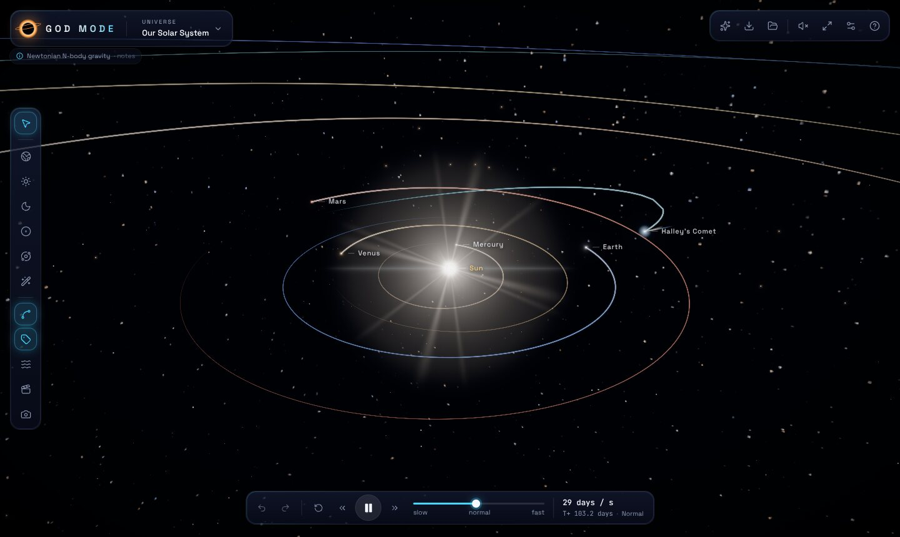
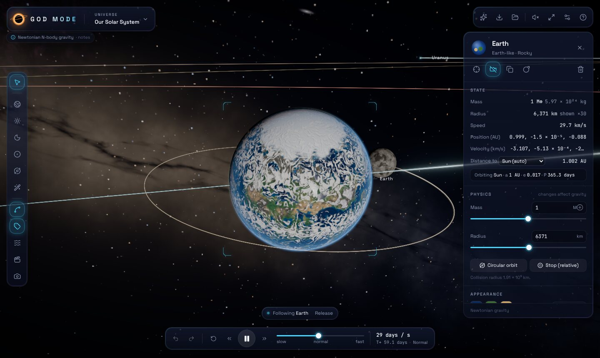
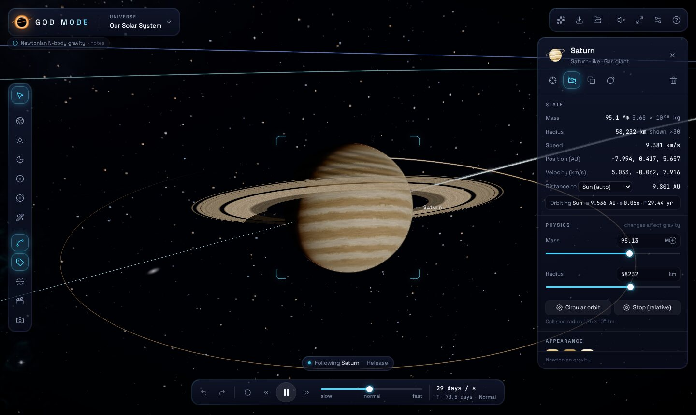
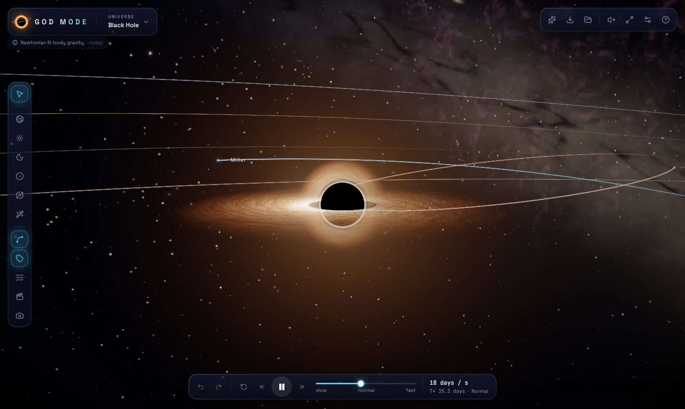
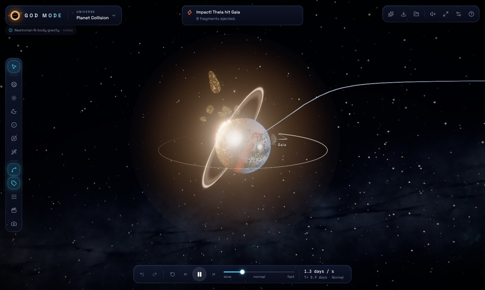
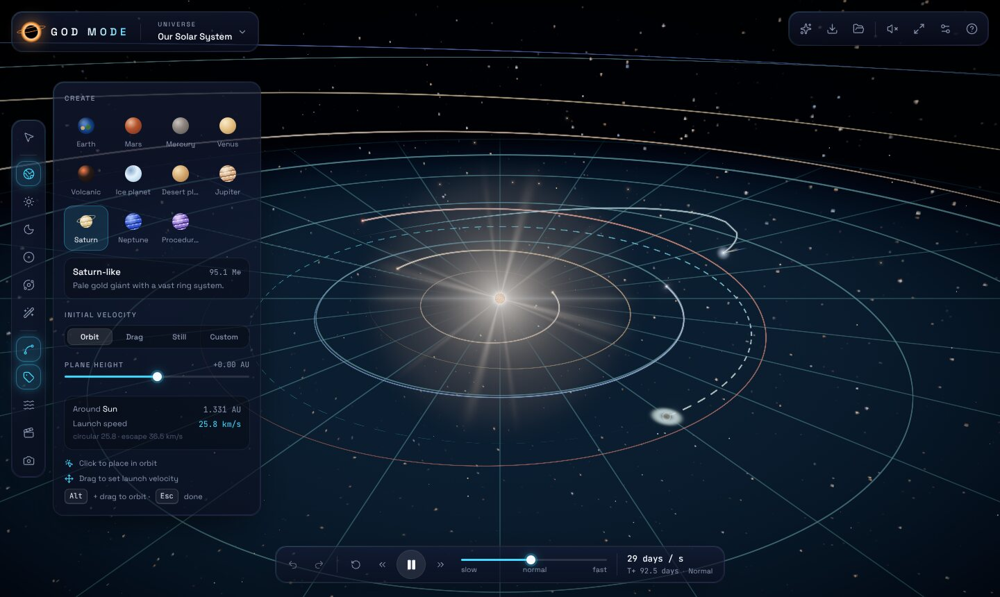
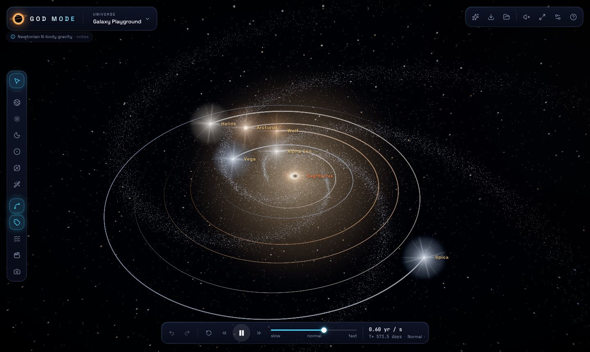

# GOD MODE

**CREATE. CONTROL. DESTROY.**

A browser-based 3D universe sandbox with a real Newtonian N-body simulation. You can build solar systems, launch planets into orbit, collide worlds and feed black holes.



| | |
|---|---|
|  |  |
|  |  |
|  |  |

*Screenshots were rendered headlessly with software WebGL (SwiftShader) at Medium quality. A real GPU at High or Ultra adds resolution, MSAA and stronger bloom.*

## Run it

Requirements: Node 20+ and a browser with WebGL 2.

```bash
npm install          # .npmrc enables legacy-peer-deps for the vitest peer range
npm run dev          # http://localhost:5173
```

| Command | What it does |
|---|---|
| `npm run build` | Type-check (`tsc -b`) and build the production bundle into `dist/` |
| `npm run preview` | Serve the production build |
| `npm test` | Vitest unit and simulation tests (no browser needed) |
| `npm run test:e2e` | Playwright browser tests against the production build |

The app needs no external services, API keys or downloaded assets. Every texture, the sky, the sound and the fonts are generated or bundled locally.

## Controls

| Input | Action |
|---|---|
| Left drag / wheel / right drag | Orbit / zoom / pan the camera |
| Click / double-click | Select / fly to and follow a body |
| `F` · `R` · `Home` | Focus selected · reset view · frame everything |
| `Space` · `+` / `−` | Pause/resume · faster/slower time |
| `1`–`7` | Select tool, then planet / star / moon / black hole / asteroid / custom creation |
| Placement: click · drag · `Alt`+drag | Place (auto circular orbit) · throw with a launch velocity · orbit the camera |
| `[` / `]` | Lower / raise the placement plane |
| `Delete` · `Ctrl Z` / `Ctrl ⇧ Z` | Delete (with confirmation) · undo / redo |
| `T` `L` `G` `C` `H` `M` | Trails, labels, gravity grid, cinematic camera, screenshot mode, mute |

## What's simulated, and what isn't

* **Gravity.** A real Newtonian N-body simulation in AU, solar masses and years (G = 4π²). It uses a kick-drift-kick leapfrog integrator with a **fixed timestep**. Each fixed step is split into bounded adaptive substeps chosen from the closest dynamical and approach times, so results never depend on frame rate. Plummer softening avoids singularities. A per-frame work budget makes extreme time speeds run slower (shown in the time bar) instead of taking unstable steps.
* **Collisions.** Contacts use body positions and collision radii. In merge mode, mass and momentum are conserved exactly and volume sets the new radius. In energy-based fragmentation, the largest remnant keeps M·(1 − Q/2Q*), a Leinhardt–Stewart-style scaling, and the rest becomes real physical fragments that can re-accrete. Mass and momentum are still conserved. No material deformation is modelled.
* **Black holes.** Newtonian point masses that absorb anything crossing an enlarged, **stylised** absorption radius, gaining its mass and momentum. The disk, photon ring, Doppler beaming, lensed far-side arc and background lensing are real-time artistic approximations, not general relativity.
* **Sizes.** Planet and moon radii are exaggerated ×30 and stars ×6 by default (configurable down to ×1). Collisions use the same enlarged radii. Jupiter's and Saturn's moons orbit farther out than in reality so they clear the enlarged planets. Masses, distances, eccentricities and inclinations of the Solar System preset use real values.
* **Lighting.** Light falls off more gently than 1/d², with bounded auto-exposure, so distant worlds stay readable.
* **Decorative only.** The galaxy's ~100k stars, the sky, the dust and the accretion-disk particles do not take part in the simulation.
* **"Shatter"** is labelled as a creative effect. It conserves mass and momentum but invents the explosion energy.

## Architecture

```
src/
  simulation/   pure TypeScript physics (no rendering): bodies, gravity, leapfrog engine,
                collisions, orbital analysis/prediction, save-file validation
  celestial/    catalog of body types with physical defaults and appearances
  presets/      six universes built from orbital elements (Kepler → state vectors)
  stores/       Zustand: world (engine singleton + undo/redo), UI, persisted settings, saves
  shaders/      GLSL: GPU planet texture bake, planet/atmosphere/ring/star/corona,
                black-hole disk/halo/lensing, sky, ribbons, VFX
  rendering/    R3F components (bodies, trails, markers, sky, grid, galaxy, post FX),
                per-frame render state, lighting, texture baker, black-hole shadow effect
  effects/      pooled GPU VFX system and synthesised Web Audio
  camera/       orbit/follow/focus/cinematic/shake rig
  controls/     picking, selection and the placement tool
  components/   UI (glass panels, toolbar, time bar, inspector, dialogs, overlay labels)
  tests/        Vitest suites
e2e/            Playwright acceptance tests
```

Physics state lives outside React. A single driver advances the engine each frame, publishes interpolated positions to a shared render-state module, and turns physics events (merges, fragmentations, absorptions) into VFX, sound and notifications. React re-renders only when bodies are added, removed or edited.

## Tests

* `npm test`: 44 Vitest tests. They cover units, circular-orbit stability and energy conservation, momentum conservation, frame-rate independence (30 fps and 144 fps give bit-identical results), pause and fast-forward, the work-budget cap, mass changes altering orbits, escape trajectories, substep bounds, merge, fragmentation, absorption and shatter conservation laws, every preset (valid, no overlaps, Solar System stable for 12 years, moons bound, binary stable, the collision preset collides, the black hole absorbs), orbital elements and prediction, and save-file round trips plus rejection of malformed files.
* `npm run test:e2e`: 11 Playwright tests covering all 15 acceptance criteria in a real browser (software WebGL): launch, stable orbit, camera, click-to-select with real data, placement plus undo, mass edit, pause and fast-forward, collision, black-hole absorption and visuals, preset switching, save/load round trip, and UI controls with no console errors.
